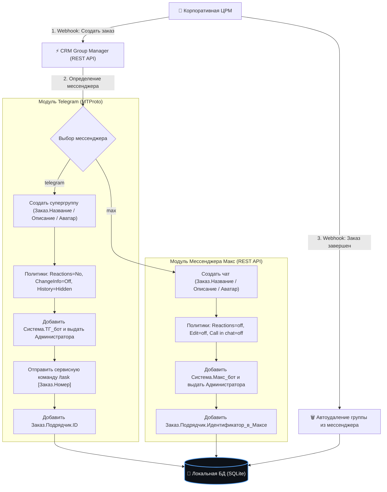

# 🤖 V1PER IT Solutions | CRM Group Manager: Управление группами в Telegram и Мессенджере МАКС

[](LICENSE)
[](https://www.python.org/)
[]()
[]()
[]()

Автономный промышленный REST API микросервис студии **V1PER IT Solutions** на **Python**, реализующий автоматическое создание, тонкую настройку политик безопасности, администрирование и удаление проектных рабочих групп в мессенджерах **Telegram** (MTProto) и **Мессенджер МАКС** по вебхукам из корпоративных CRM-систем (Битрикс24, amoCRM, Custom ERP).

> [!IMPORTANT]
> **🚀 Корпоративная интеграция и внедрение CRM-менеджера под ключ:**  
> В данном репозитории представлена базовая открытая архитектура микросервиса. Студия **V1PER IT Solutions** выполняет разработку и интеграцию решения под ключ в IT-контур вашей компании:
> - 🏢 **Связка с вашей CRM/ERP:** интеграция с Битрикс24, amoCRM, 1С, RetailCRM или собственной базой через REST API и вебхуки.
> - 👥 **Автоматизация чатов сделок:** создание групп, приглашение ответственных сотрудников и клиентов, выдача и отзыв прав.
> - 💬 **Сквозная синхронизация:** двустороннее зеркалирование переписки между Telegram и Мессенджером МАКС.
> - 🛡️ **Безопасность и аудит:** предотвращение утечек данных, скрытие номеров и детальный аудит всех действий.
>
> 📩 **Заказать корпоративную интеграцию:** [Создать заявку (Issue)](https://github.com/viper86rus-arch/CRM_Group_Manager/issues) или написать в [Профиль студии V1PER](https://github.com/viper86rus-arch).

---

## 📋 Реализованные сценарии ТЗ



---

## 🚀 Архитектурные особенности

1. **Zero-Pip Baseline (Чистый Python)**:
   * Ядро сервера построено на стандартных библиотеках Python (`http.server`, `asyncio`, `sqlite3`, `urllib`).
   * Встроенный режим изоляции `--demo` позволяет запускать и тестировать 100% сценариев ТЗ без внешних API-ключей и сторонних зависимостей.
2. **MTProto-оркестрация Telegram**:
   * Обычный Telegram Bot API запрещает ботам создавать супергруппы с нуля.
   * Данный микросервис решает проблему через надежный клиент MTProto (`Telethon`), который программно поднимает чат, передает права администратора корпоративному боту и закрепляет задачу через `/task [Номер]`.
3. **Единый коннектор к мессенджеру Макс**:
   * Взаимодействие с корпоративным сервером Макс через защищенный REST API с Bearer-авторизацией.
4. **Гарантированная дедупликация**:
   * Локальная база данных SQLite предотвращает повторное создание дублирующих групп при повторных вебхуках от CRM.

---

## 🛠️ Спецификация REST API

### 1. Проверка работоспособности (Healthcheck)
```http
GET /health
```
**Ответ `200 OK`:**
```json
{
  "status": "healthy",
  "service": "CRM Group Manager",
  "version": "1.0.0",
  "author": "V1PER (viper86rus-arch)",
  "active_messengers": ["telegram", "max"],
  "demo_mode": true
}
```

---

### 2. Создание группы под новый Заказ
```http
POST /api/v1/groups/create
Content-Type: application/json
```
**Тело запроса (Telegram):**
```json
{
  "order_id": "ORD-1082",
  "title": "Заказ #1082: Поставка серверного оборудования",
  "description": "Рабочая группа проекта ЦОД. Заказчик: ООО Вектор",
  "contractor_id": "@network_specialist",
  "messenger": "telegram",
  "avatar_url": "https://company.ru/avatars/order_1082.png",
  "task_number": "1082"
}
```

**Тело запроса (Макс):**
```json
{
  "order_id": "ORD-1083",
  "title": "Заказ #1083: Аудит информационной безопасности",
  "description": "Закрытая группа аудита инфраструктуры",
  "contractor_id": "max_user_99120",
  "messenger": "max"
}
```

**Ответ `200 OK`:**
```json
{
  "success": true,
  "order_id": "ORD-1082",
  "message": "Группа в Telegram успешно создана и сконфигурирована по ТЗ",
  "group_id": "-1001001001",
  "invite_link": "https://t.me/c/1001001/1",
  "error": null
}
```

---

### 3. Завершение заказа и автоудаление группы
```http
POST /api/v1/groups/delete
Content-Type: application/json
```
```json
{
  "order_id": "ORD-1082",
  "reason": "Работы приняты заказчиком"
}
```

---

## 💻 Установка и запуск

### Быстрый запуск в демонстрационном режиме
Для проверки всех сценариев создания, настройки и удаления групп:
```bash
python3 server.py --demo
```

### Запуск постоянного фонового сервера
```bash
python3 server.py --host 0.0.0.0 --port 8000
```

### Запуск набора модульных тестов
```bash
python3 -m unittest discover -s tests -v
```

---

## ⚙️ Конфигурация (`.env`)

Скопируйте шаблон переменных окружения:
```bash
cp .env.example .env
```

| Переменная | Описание | По умолчанию |
| :--- | :--- | :--- |
| `SERVER_HOST` | Сетевой интерфейс для прослушивания | `0.0.0.0` |
| `SERVER_PORT` | Порт HTTP REST API сервиса | `8000` |
| `TG_API_ID` | Telegram API ID приложения (my.telegram.org) | `0` |
| `TG_API_HASH` | Telegram API Hash приложения | `""` |
| `TG_CORPORATE_BOT_ID` | Идентификатор корпоративного бота | `@corp_bot` |
| `MAX_API_URL` | Базовый URL REST API Мессенджера МАКС | `https://platform-api2.max.ru` |
| `MAX_API_TOKEN` | Корпоративный токен авторизации Макс | `""` |
| `DEMO_MODE` | Режим работы (true / false) | `true` |

---

## 📄 Лицензия и авторство

* **Автор разработки:** V1PER ([`viper86rus-arch`](https://github.com/viper86rus-arch))
* **Лицензия:** [MIT License](LICENSE) (2026) — открытый исходный код без ограничений на коммерческое и образовательное применение.
